# Windows + VS Code + WSL2 使用 RuyiSDK 插件

更新日期：2026-10-23

## 1. 检查 WSL2

在 Windows PowerShell 或 Windows VS Code 的 PowerShell 集成终端运行：

~~~powershell
wsl --version
wsl --status
wsl --list --verbose
~~~

确认列表中有 Ubuntu，且 VERSION 为 2。录像中的前景 VS Code 终端显示了检查命令、Ubuntu 的 WSL 2 版本和启动结果。

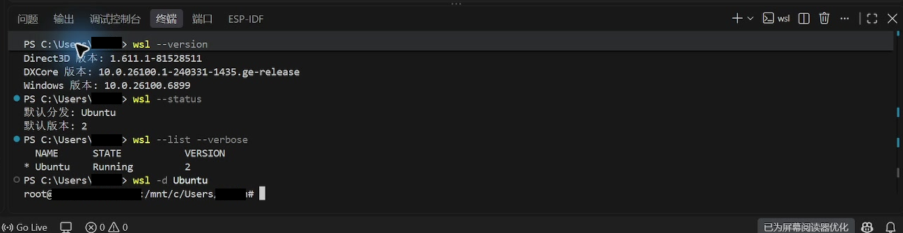

如果没有 Ubuntu，可运行 <code>wsl --install -d Ubuntu</code>，按提示完成首次启动并创建 Linux 用户。已有发行版时，可用 <code>wsl -d Ubuntu</code> 确认能启动。

若报 <code>HCS_E_SERVICE_NOT_AVAILABLE</code> 或 <code>0x80370102</code>，先检查 Windows“适用于 Linux 的 Windows 子系统”和“虚拟机平台”功能、固件虚拟化，以及虚拟机是否开放嵌套虚拟化。Windows 功能变更后需重启；

本机的 HCS 故障由管理员 PowerShell 执行以下命令后解决。启用功能后重启 Windows，再更新并启动发行版：

~~~powershell
Enable-WindowsOptionalFeature -Online -FeatureName Microsoft-Windows-Subsystem-Linux -All -NoRestart
Enable-WindowsOptionalFeature -Online -FeatureName VirtualMachinePlatform -All -NoRestart
bcdedit /set hypervisorlaunchtype auto
# 重启 Windows 后：
wsl --update
wsl --shutdown
wsl -d Ubuntu
~~~

## 2. 从 Windows VS Code 连接 Ubuntu

1. 在 Windows 版 VS Code 扩展视图安装 Microsoft **WSL** 扩展（<code>ms-vscode-remote.remote-wsl</code>）。
2. 按 <code>Ctrl+Shift+P</code>，选择 **WSL: Connect to WSL using Distro...**。
3. 在发行版列表中选择 **Ubuntu** 并等待远程窗口启动。

图 1：命令面板中高亮的是按发行版连接 WSL 的命令。

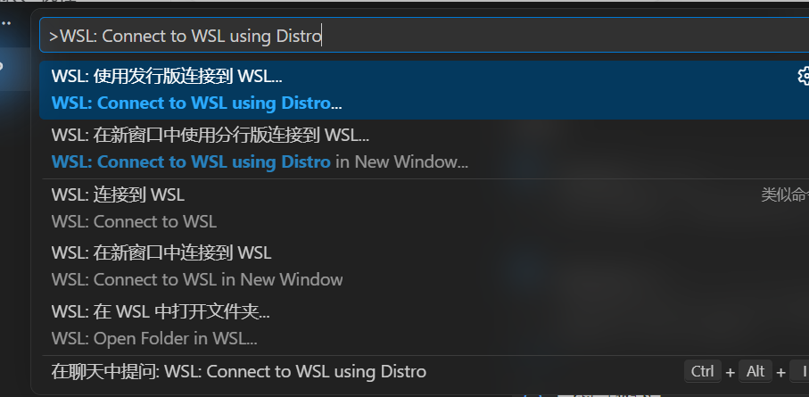

图 2：选择前的发行版列表中 Ubuntu 行已高亮；点击该行或按 Enter。

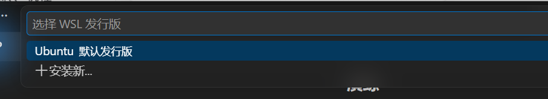

连接后确认左下角显示 **WSL: Ubuntu**。下图同时显示远程窗口中的 Ruyi 版本状态。

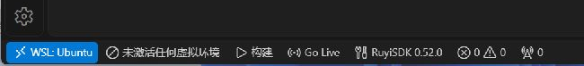

### 打开 WSL 项目目录

连接后运行命令面板 **WSL: Open Folder in WSL...**，再输入 Linux 路径；也可在 Ubuntu 终端创建目录后用 <code>code .</code> 打开。不要把 <code>C:\...</code> Windows 路径填入 WSL 文件夹框。

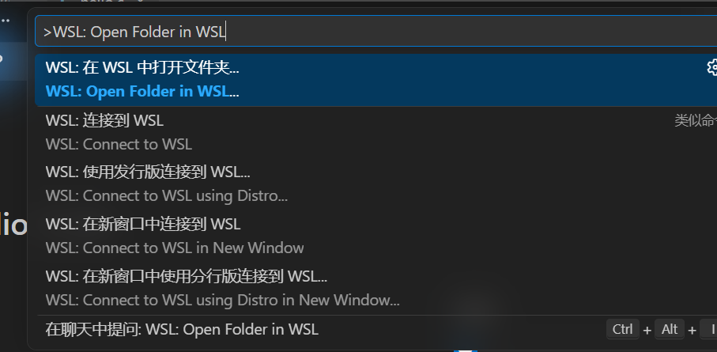

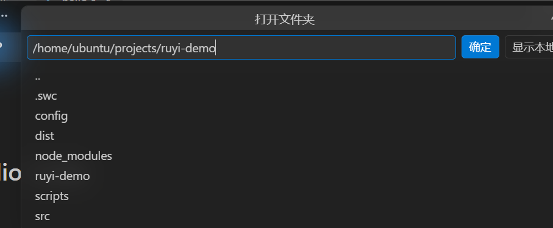

本机路径为 <code>/home/ubuntu/projects/ruyi-demo</code>；请按自己的 Linux 用户替换路径。源码建议放在 WSL 的 Linux 文件系统中；Windows 磁盘可经 <code>/mnt/c/...</code> 访问。

## 3. 在 WSL 端安装 RuyiSDK 插件

在左下角显示 **WSL: Ubuntu** 的窗口中打开扩展视图，搜索 **RuyiSDK**，选择 **Install in WSL: Ubuntu**。完成后扩展详情应显示已在 WSL 端启用；

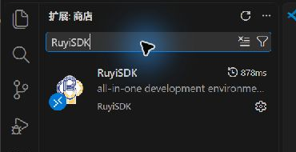

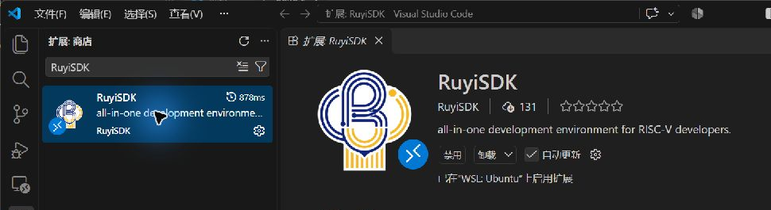

若 Ruyi 侧栏未出现，运行 **Developer: Reload Window** 并确认仍在 WSL 远程窗口。

## 4. 安装并检测 Linux Ruyi CLI

在 WSL 集成终端检查架构和 Ruyi：

~~~bash
uname -m
command -v ruyi
ruyi version
~~~

Ubuntu x64 应显示 <code>x86_64</code>。如果还没有 CLI，可按 [RuyiSDK 官方安装文档](https://ruyisdk.org/docs/Package-Manager/installation/)获取对应架构的二进制。本次使用 Ruyi 0.52.0 的 ISCAS x86_64 文件：

~~~bash
wget https://mirror.iscas.ac.cn/ruyisdk/ruyi/tags/0.52.0/ruyi-0.52.0.amd64 -O /tmp/ruyi
install -m 0755 /tmp/ruyi /usr/local/bin/ruyi
ruyi version
~~~

测试发行版使用 <code>root</code>，所以安装命令没有 <code>sudo</code>；普通用户需在第二行前加 <code>sudo</code>。Ruyi 包、虚拟环境和 VS Code Server 都属于当前 Linux 用户，安装和连接应使用同一用户。

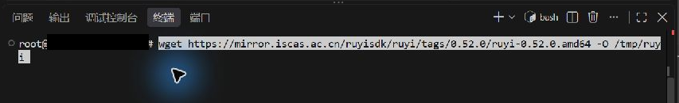

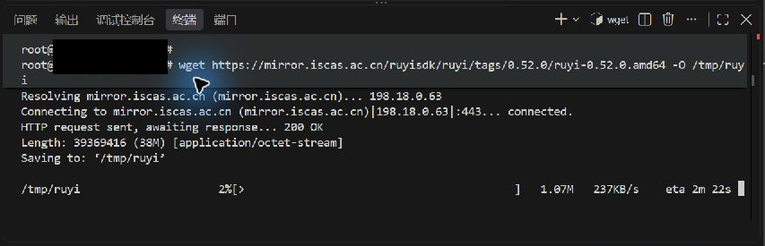

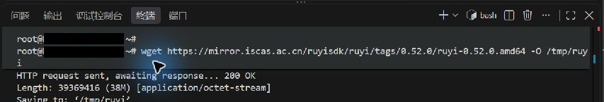

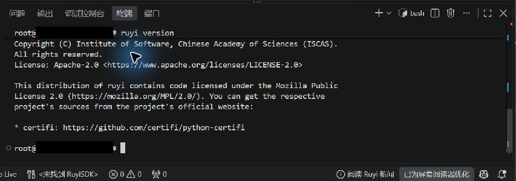

安装后运行命令面板 **Ruyi: 检测 Ruyi 安装**，选择 CLI。本机检测到 <code>/usr/local/bin/ruyi</code>、版本 0.52.0。

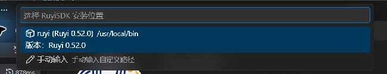

若 WSL 终端能运行 Ruyi、插件却找不到它，检查远程设置的 <code>ruyi.ruyiPath</code> 和 <code>PATH</code>。VS Code Server 启动时不执行常规 shell 启动脚本；可按 [VS Code 远程环境设置说明](https://code.visualstudio.com/docs/remote/wsl#_advanced-environment-setup-script)配置 <code>~/.vscode-server/server-env-setup</code>。

## 5. 查看包并安装 RISC-V 工具链

点击活动栏的 Ruyi 图标，在 **RuyiSDK 软件包**视图确认分类可加载。

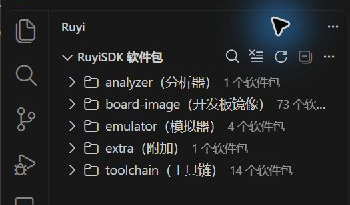

在 **toolchain** 分类展开 <code>gnu-upstream</code>，选择版本并点击安装图标。确认提示中的版本与包名，再点击 **安装**。

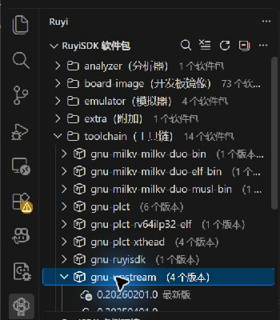

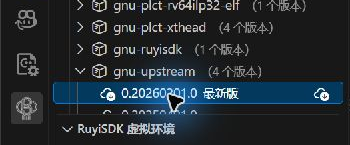

本次在扩展包视图选择 <code>gnu-upstream</code> 时下载失败，提示中的镜像地址不完整。随后在 WSL 终端使用 CLI 安装成功：

~~~bash
ruyi install gnu-upstream
~~~

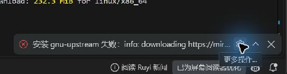

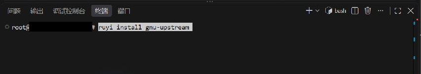

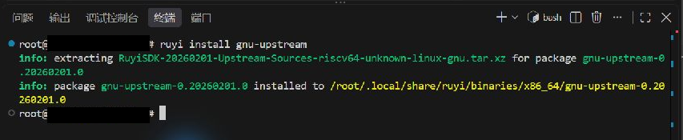

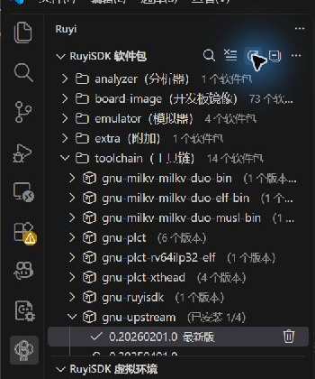

本机安装 <code>gnu-upstream 0.20260201.0</code>，下载约 177 MiB。

## 6. 创建并激活插件虚拟环境

在 Ruyi 侧栏 **RuyiSDK 虚拟环境**区域点击 **+** 创建按钮。向导依次设置 Profile、工具链、模拟器、sysroot 和虚拟环境路径。本次截图中的示例目录是 <code>./.venv-wizard-demo</code>；如果该目录已存在，请改成尚未使用的目录。

1. 选择 Profile <code>generic</code>。

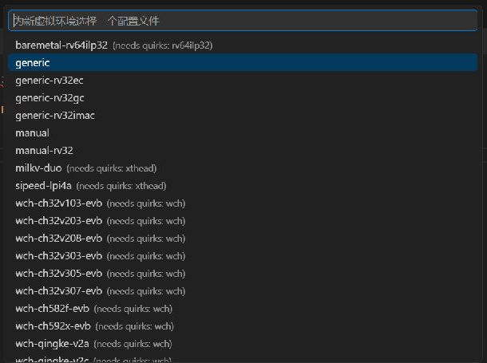

2. 搜索并勾选已安装的 <code>gnu-upstream 0.20260201.0</code>，点击右上角 **确定**。

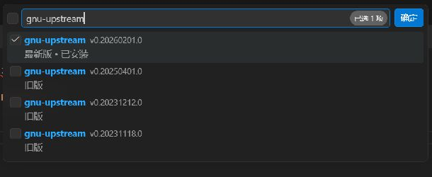

3. 若只需交叉编译，选择 **否**，不把模拟器加入此环境。

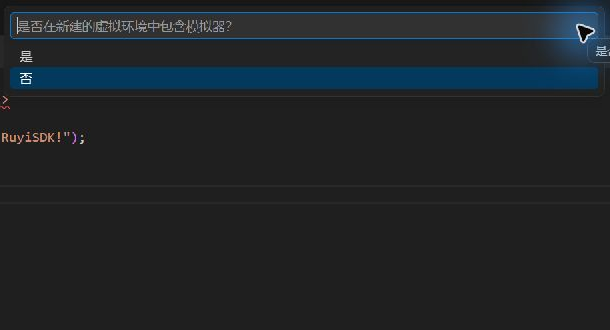

4. 不需要 sysroot 时选择 **已禁用**。

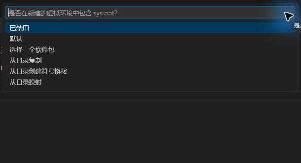

5. 在路径输入框填写 <code>./.venv-wizard-demo</code> 并按 Enter。可选描述留空，再按 Enter 完成创建。

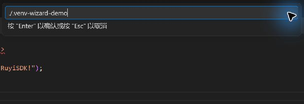

6. 点击新环境行的激活图标。左下角状态栏会显示当前活动环境名称。

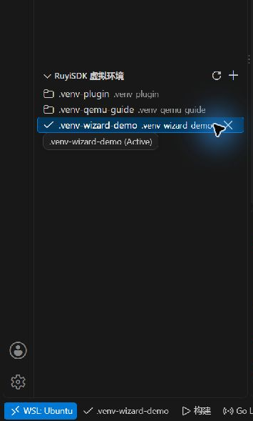

Ruyi Venv Terminal 会加载激活环境的工具。下图显示本次向导创建的 <code>.venv-wizard-demo</code>、由 CLI 创建并由扩展发现的 <code>.venv-qemu-guide</code>；终端保留了交叉编译和 QEMU 成功输出。

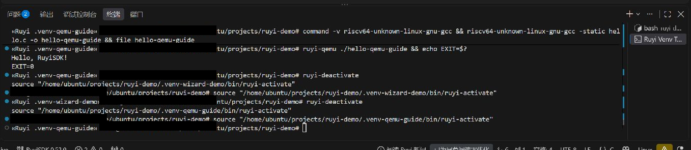

VS Code Server 不会执行普通 shell 启动脚本。Ruyi Venv Terminal 会加载插件激活的环境；若新开普通终端，确认目标环境已激活且编译器在 <code>PATH</code> 中。

## 7. 安装 QEMU 并运行示例

本次通过 WSL Ruyi CLI 安装模拟器并创建带模拟器的环境，再让插件刷新和激活它：

~~~bash
ruyi install qemu-user-riscv-upstream
ruyi venv generic .venv-qemu-guide \
  --toolchain gnu-upstream \
  --emulator qemu-user-riscv-upstream \
  --without-sysroot
~~~

扩展的 **模拟器**分类也可查看版本。下图是版本列表和安装确认提示；实际安装成功来自 WSL CLI。

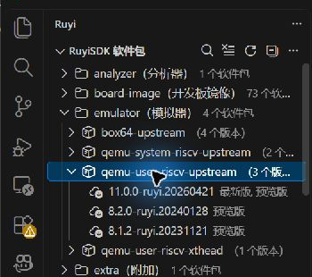

运行命令面板 **Ruyi: 检测虚拟环境**，在侧栏激活 <code>.venv-qemu-guide</code>。新建 <code>hello.c</code>：

~~~c
#include <stdio.h>

int main(void) {
    puts("Hello, RuyiSDK!");
    return 0;
}
~~~

在 Ruyi Venv Terminal 运行：

~~~bash
command -v riscv64-unknown-linux-gnu-gcc
riscv64-unknown-linux-gnu-gcc -static hello.c -o hello-qemu-guide
file hello-qemu-guide
ruyi-qemu ./hello-qemu-guide
echo EXIT=$?
~~~

通过标志是编译器位于虚拟环境的 <code>bin</code> 目录、文件为静态 RISC-V ELF，QEMU 输出 <code>Hello, RuyiSDK!</code> 和 <code>EXIT=0</code>。

## 常见问题

| 现象 | 检查方法 |
| --- | --- |
| Ubuntu 无法启动 | 检查 WSL、虚拟机平台、固件虚拟化、嵌套虚拟化和系统服务；此时 VS Code/Ruyi 尚未参与。 |
| 左下角没有 WSL: Ubuntu | 运行 **WSL: Connect to WSL using Distro...** 并选择 Ubuntu；确认 Windows 端安装 Microsoft WSL 扩展。 |
| 插件只显示在 Local | 在远程窗口扩展详情选择 **Install in WSL: Ubuntu**，确认远程启用状态。 |
| 插件找不到 Ruyi | 检查远程设置 <code>ruyi.ruyiPath</code>，运行 <code>command -v ruyi</code>；远程服务默认不读取 <code>.bashrc</code>。 |
| 刚安装 Ruyi 后插件未识别 | 运行 **Ruyi: 检测 Ruyi 安装**，选择 Linux 中的实际路径。 |
| 包列表无法加载 | 检查 Ruyi 源索引、WSL DNS/代理/防火墙和镜像连通性；Marketplace 与 Ruyi 镜像需分别排查。 |
| 扩展下载失败但 CLI 可用 | 在 WSL 终端运行 <code>ruyi install &lt;包名&gt;</code>，查看完整报错和镜像地址。 |
| 虚拟环境未出现在侧栏 | 运行 **Ruyi: 检测虚拟环境**刷新，再激活目标环境。 |
| 找不到交叉编译器 | 确认工具链已安装、正确环境处于活动状态，并在 Ruyi Venv Terminal 检查 <code>command -v</code>。 |
| <code>ruyi-qemu</code> 提示未配置模拟器 | 激活创建时指定了 <code>qemu-user-riscv-upstream</code> 的环境。 |
| 路径或权限异常 | 检查 <code>pwd</code>、<code>whoami</code> 和 <code>echo "$HOME"</code>；Ruyi 包及虚拟环境归当前 Linux 用户所有。 |
| VS Code Server 或扩展下载失败 | Windows 与 WSL 的代理可能不同。按 [VS Code WSL 网络要求](https://code.visualstudio.com/docs/remote/wsl#_what-are-the-connectivity-requirements-for-the-wsl-extension)检查对更新站点、Marketplace 和 CDN 的 HTTPS 访问。 |

## 本机环境
| 环境 | 结果 |
| --- | --- |
| Windows | Windows 11 专业工作站版，Build 26100，x64 |
| VS Code 客户端 | 1.143.0，Commit <code>2d0b7506a36c1d6db9a466440131a8e01eab2289</code> |
| WSL | Ubuntu 24.04.1 LTS，Linux kernel <code>6.18.40.1-microsoft-standard-WSL2</code>，x86_64，WSL 2 |
| Remote - WSL / RuyiSDK 插件 | 0.104.5 / 0.1.7，插件在 WSL 端启用 |
| Ruyi CLI | 0.52.0，<code>/usr/local/bin/ruyi</code> |
| 工具链 | <code>gnu-upstream 0.20260201.0</code>，安装到当前 Linux 用户的 Ruyi 包目录 |
| 虚拟环境 | <code>.venv-wizard-demo</code> 由插件向导创建并激活；<code>.venv-qemu-guide</code> 由 CLI 创建，插件检测并激活 |
| 编译与运行 | 静态 RISC-V ELF 64-bit；QEMU 输出 <code>Hello, RuyiSDK!</code>，退出码 0 |
 |

## 参考资料

- [VS Code：Developing in WSL](https://code.visualstudio.com/docs/remote/wsl)
- [Microsoft Learn：使用 VS Code 和 WSL](https://learn.microsoft.com/windows/wsl/tutorials/wsl-vscode)
- [RuyiSDK：平台支持情况](https://ruyisdk.org/docs/Other/platform-support/)
- [RuyiSDK：Ruyi 包管理器安装](https://ruyisdk.org/docs/Package-Manager/installation/)
- [RuyiSDK：VS Code 插件功能概览](https://ruyisdk.org/docs/VSCode-Plugins/)
- [RuyiSDK：VS Code 插件虚拟环境](https://ruyisdk.org/docs/VSCode-Plugins/venv/)
- [RuyiSDK VS Code 插件 Marketplace 页面](https://marketplace.visualstudio.com/items?itemName=RuyiSDK.ruyisdk-vscode-extension)

