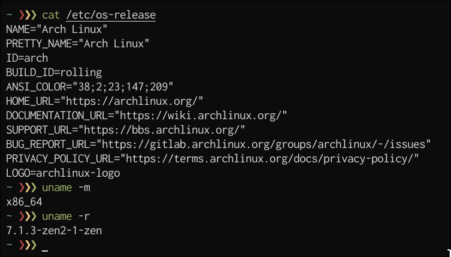
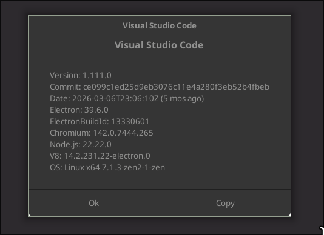
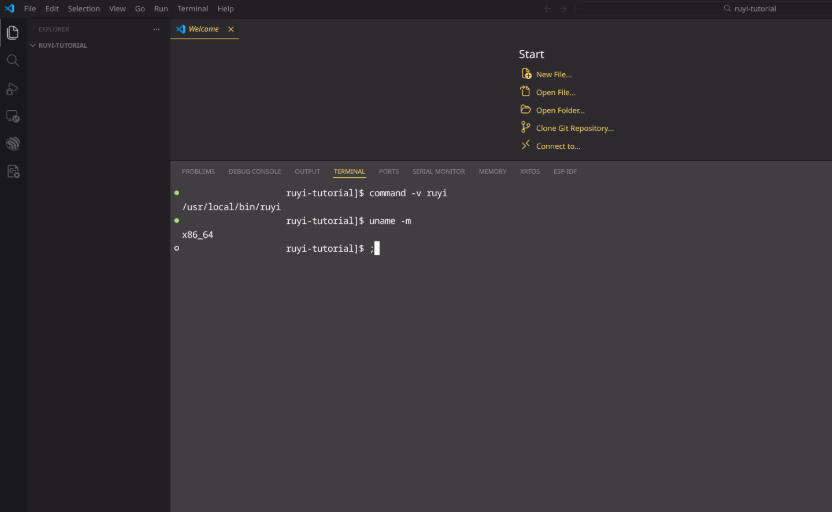

# 【RuyiSDK VS Code 扩展】Linux 篇 01：准备 VS Code 或 VSCodium

> 我的截图环境：Arch Linux / x86_64，VS Code 1.111.0

这次整理环境时，我先记下 Linux 发行版、主机架构和 IDE 版本。后面如果遇到软件包无法安装或扩展行为不同，这几项信息通常最先用得上。

## 先记下主机环境

打开终端，执行：

```bash
cat /etc/os-release
uname -m
uname -r
```

`uname -m` 显示的是运行 IDE 和编译器的 Host 架构。我这里是 `x86_64`。如果你的结果是 `aarch64` 或 `riscv64`，也可以继续往下做，不过后面某个工具链或 QEMU 包能否安装，要以 Packages 视图中显示的 Host 支持情况为准。

我后面会把 Host 和 Target 分开说：

- Host：运行 VS Code、Ruyi 和交叉编译器的 Linux 主机。
- Target：最终运行程序的 RISC-V Linux 环境。

如果 Host 本身就是 `riscv64`，与本机 ABI 匹配的 RISC-V 程序有可能直接运行；在 `x86_64` 或 `aarch64` 主机上，则通常需要交叉编译和 QEMU。



*图 01-01：我先记录 Host 的发行版、架构和内核版本；截图环境为 Arch Linux/x86_64。*

## 选择 VS Code 还是 VSCodium

这套流程不强制二选一。我截图时用的是 VS Code；如果你平时使用 VSCodium，后面的扩展安装和工作区操作也基本相同。

先检查已经安装的版本：

```bash
code --version
```

VSCodium 对应的命令是：

```bash
codium --version
```

RuyiSDK 扩展当前要求 VS Code 1.88.0 或更高版本。VSCodium 基于 VS Code 源码，但默认连接 Open VSX，而不是 Microsoft Visual Studio Marketplace，这个差别会影响下一篇的扩展安装方式。

### 安装 VS Code

我会从 [VS Code 官方下载页](https://code.visualstudio.com/Download)选择与发行版和主机架构匹配的软件包。以 Debian/Ubuntu 的本地 `.deb` 为例：

```bash
sudo apt install ./code_VERSION_ARCH.deb
code --version
```

这里的 `VERSION_ARCH` 只是文件名占位，实际执行时换成刚下载的 `.deb` 文件。

### 安装 VSCodium

VSCodium 的安装方式随发行版不同，可以从 [VSCodium 安装页](https://vscodium.com/install)选择软件仓库、Snap、Flatpak 或发行版提供的软件包。

如果系统已经配置好 Snap：

```bash
sudo snap install codium --classic
codium --version
```

使用 Flatpak 时，命令通常是：

```bash
flatpak install flathub com.vscodium.codium
flatpak run com.vscodium.codium
```

我没有把 Flatpak 作为后续实操的主线，因为扩展还要调用工作区外部的 `ruyi`、工具链和虚拟环境；如果你选择 Flatpak，需要额外留意沙箱带来的路径和文件访问权限。

在 riscv64 Linux 上，各发行版的软件源和构建情况差异较大。我会先确认下载页或发行版仓库确实提供 riscv64 包，再决定使用哪种安装方式。



*图 01-02：我在“关于”窗口里核对 VS Code 版本和运行平台。*

## 打开一个工作区

后面的构建功能会在工作区根目录查找 `CMakeLists.txt`、`Makefile` 或 C 源文件。为了让扩展找到工程入口，这里直接创建目录，再通过“文件 → 打开文件夹”打开：

```bash
mkdir -p ~/workspace/ruyi-tutorial
```

本仓库后面还会提供 `examples/hello-ruyi` 示例工程，等写到示例章节时可以直接把那个目录作为工作区打开。

## 远程与容器环境要看哪一侧

使用 Remote SSH、Dev Containers 或类似功能时，IDE 窗口显示在本机，扩展和终端却可能运行在远端或容器里。Ruyi、工具链和虚拟环境应该装在真正执行构建命令的那一侧。

我通常直接在集成终端里执行：

```bash
uname -m
command -v ruyi
```

后续文章里提到的 Host，指的就是这个集成终端所在的环境。



*图 01-03：打开工作区后，我在集成终端核对 `ruyi` 路径和 Host 架构；终端身份信息已遮挡。*

做到这里，我会确认 IDE 版本不低于 1.88.0、工作区能正常打开，并且已经知道后续命令实际运行在本机、远端还是容器里。下一篇再单独处理扩展安装。

## 相关链接

- [VS Code 下载](https://code.visualstudio.com/Download)
- [VS Code 的 Linux 安装说明](https://code.visualstudio.com/docs/setup/linux)
- [VSCodium 安装](https://vscodium.com/install)
- [VSCodium 的扩展与 Marketplace 说明](https://github.com/VSCodium/vscodium/blob/master/docs/extensions.md)
- [RuyiSDK 扩展安装要求](https://ruyisdk.org/docs/VSCode-Plugins/installation/)

下一篇：[安装 RuyiSDK 扩展](02-extension-install.md)
