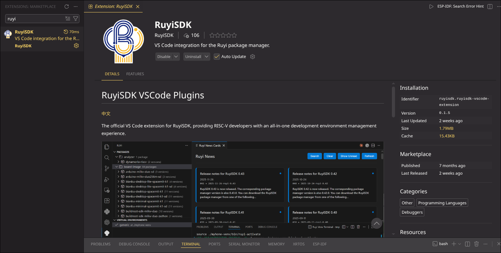
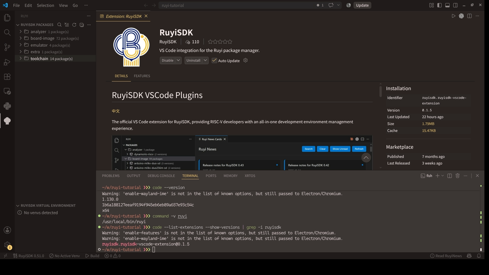

# 【RuyiSDK VS Code 扩展】Linux 篇 02：安装 RuyiSDK 扩展


这一篇先只处理扩展本身，不急着安装 Ruyi。这样如果中途出问题，可以先判断是“扩展没有装好”，还是“扩展找不到 Ruyi”，不必把两件事混在一起排查。

## 在 VS Code 中在线安装

1. 打开左侧“扩展”视图。
2. 搜索 `RuyiSDK`。
3. 打开详情页，核对发布者和扩展 ID。扩展 ID 应为 `RuyiSDK.ruyisdk-vscode-extension`。
4. 点击“安装”，完成后按提示重载窗口。

也可以在终端安装：

```bash
code --install-extension RuyiSDK.ruyisdk-vscode-extension
```

我会再用下面的命令确认一次：

```bash
code --list-extensions --show-versions | grep -i ruyisdk
```

输出会类似：

```text
ruyisdk.ruyisdk-vscode-extension@实际版本号
```

扩展版本会继续更新，不需要和截图完全相同；记录自己实际安装的版本更有用。



*图 02-01：在详情页核对 RuyiSDK 发布者、扩展 ID、版本和安装状态；截图使用 0.1.5。*

## 无法访问扩展市场时

网络环境无法访问扩展市场时，可以从 [扩展 Releases](https://github.com/ruyisdk/ruyisdk-vscode-extension/releases)下载对应版本的 `.vsix`。

在扩展视图右上角的菜单里选择“从 VSIX 安装”，也可以直接执行：

```bash
code --install-extension "./ruyisdk-vscode-extension_VERSION.vsix"
```

我习惯给文件路径保留双引号，这样下载目录中有空格时也不会出错。安装结束后，仍然使用前面的 `--list-extensions --show-versions` 命令检查版本。

## 在 VSCodium 中安装

VSCodium 默认使用 Open VSX。RuyiSDK 是否能直接搜索到，要看对应版本是否已经同步到 Open VSX；RuyiSDK 下载页也提供 Open VSX 和 Marketplace 入口。

如果暂时搜不到，从扩展的 GitHub Releases 下载 `.vsix`，再执行：

```bash
codium --install-extension "./ruyisdk-vscode-extension_VERSION.vsix"
codium --list-extensions --show-versions | grep -i ruyisdk
```

不建议只为了某一个扩展就把 VSCodium 改接 Microsoft Marketplace。使用维护者发布的 VSIX，来源和版本更容易核对。

## 第一次打开 Ruyi 侧边栏

安装完成后，活动栏会出现 Ruyi 图标。点击后，我会先看两个视图是否都能展开：

- `RuyiSDK 软件包`，英文界面显示为 `RuyiSDK Packages`；
- `RuyiSDK 虚拟环境`，英文界面显示为 `RuyiSDK Virtual Environment`。

扩展还带有开始使用页，后面的功能介绍会再单独展开。这里先确认入口能看到即可。

如果活动栏没有 Ruyi 图标，我会先回到扩展详情页确认它没有被禁用，再执行“开发人员：重新加载窗口”。



*图 02-03：安装扩展后，活动栏出现 Ruyi 图标，侧边栏可以展开软件包和虚拟环境视图。*

如果要提交 Issue，我会把下面三项一起附上，省得维护者再来回确认环境：

```bash
code --version
code --list-extensions --show-versions | grep -i ruyisdk
uname -m
```

VSCodium 用户把 `code` 换成 `codium`。走到这里，只要扩展 ID 正确、Ruyi 图标出现、两个侧边栏视图都能展开，就可以进入下一篇处理 Ruyi 路径。

## 相关链接

- [RuyiSDK 扩展安装文档](https://ruyisdk.org/docs/VSCode-Plugins/installation/)
- [RuyiSDK 下载页](https://ruyisdk.org/downloads/)
- [扩展官方仓库](https://github.com/ruyisdk/ruyisdk-vscode-extension)
- [扩展 Releases](https://github.com/ruyisdk/ruyisdk-vscode-extension/releases)
- [VSCodium 扩展说明](https://github.com/VSCodium/vscodium/blob/master/docs/extensions.md)

上一篇：[准备 VS Code 或 VSCodium](01-ide-setup.md)

下一篇：[让扩展找到 Ruyi](03-ruyi-setup.md)
