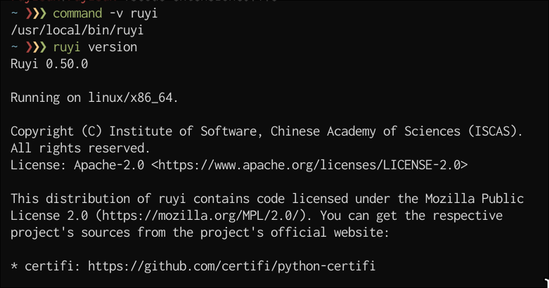
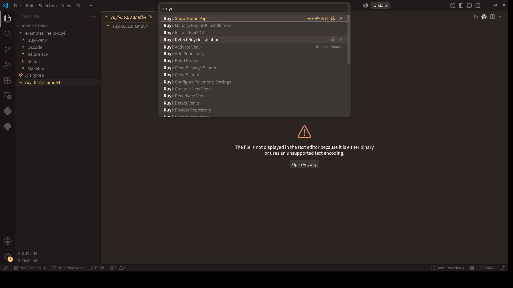
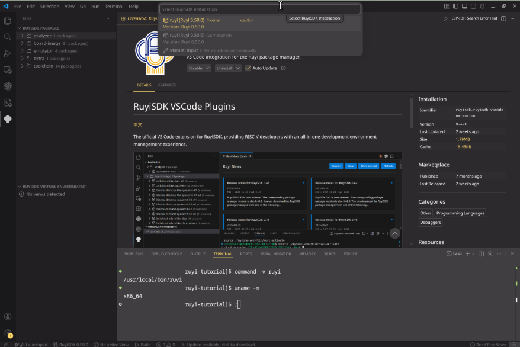
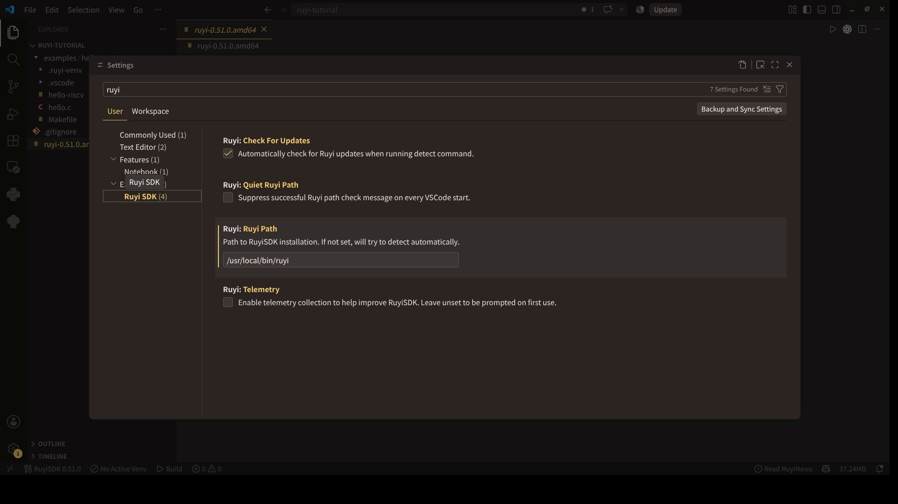

# 【RuyiSDK VS Code 扩展】Linux 篇 03：让扩展找到 Ruyi

> 我的截图环境：Arch Linux / x86_64，Ruyi 0.50.0，RuyiSDK 扩展 0.1.5

我遇到过这样的情况：普通终端里能执行 `ruyi`，从桌面图标启动的 VS Code 却检测不到。通常不是 Ruyi 本身坏了，而是两种启动方式拿到的 `PATH` 不一样。这一篇记录我实际保留的三种入口：扩展安装、自动检测和手动指定路径。

## 还没有安装 Ruyi

扩展找不到 Ruyi 时会给出安装或配置提示，也可以从命令面板执行：

```text
Ruyi: Install RuyiSDK
```

中文界面对应“Ruyi: 安装 RuyiSDK”。当前扩展会在 Linux 上尝试使用 pip 或 pipx 自动安装；这个入口可以用，但 Ruyi 官方文档仍提示 pipx 与虚拟环境集成存在已知问题。

为了让后面的虚拟环境和 `ruyi-qemu` 更容易排查，我自己的主线使用官方推荐的预编译安装脚本：

```bash
curl --proto '=https' --tlsv1.2 -fsSL https://ruyisdk.org/install.sh | sh
```

脚本会识别主机架构，默认把可执行文件安装到：

```text
~/.local/bin/ruyi
```

如果确实希望所有用户共用，再选择系统目录：

```bash
curl --proto '=https' --tlsv1.2 -fsSL https://ruyisdk.org/install.sh | sudo sh -s -- --install-dir /usr/local/bin
```

安装结束后，我会重新打开终端并执行：

```bash
command -v ruyi
ruyi version
ruyi --help
ruyi update
```

用户目录安装时，`command -v ruyi` 通常返回 `/home/USERNAME/.local/bin/ruyi`；系统级安装通常返回 `/usr/local/bin/ruyi`。



*图 03-01：我用 `command -v ruyi` 和 `ruyi version` 核对安装结果；截图为 Ruyi 0.50.0、Linux/x86_64。*

如果你已经习惯用 pip 管理 Python 工具，也可以按当前官方安装页操作。不过初次跟这套流程时，我更建议先用预编译二进制，少引入一层 Python 环境变量和依赖问题。

## 终端已经能找到 Ruyi

先在 VS Code 的集成终端中取到绝对路径：
../assets/images/
```bash
command -v ruyi
```

然后打开命令面板，执行：

```text
Ruyi: Detect Ruyi Installation
```

中文界面为“Ruyi: 检测 Ruyi 安装”。检测成功后，扩展会提示 Ruyi 的路径和版本。



*图 03-02：我在命令面板中搜索完整的 `Ruyi: Detect Ruyi Installation`，避免和其他 Ruyi 命令混淆。*

如果自动检测没有找到，继续执行：

```text
Ruyi: Manage RuyiSDK Installations
```

中文界面为“Ruyi: 管理已安装的 RuyiSDK”。列表里可以选择自动发现的安装，也可以使用 `Manual Input` 手动选择 `ruyi` 文件。这里要选具体的可执行文件，不是它的上级目录。



*图 03-03：自动检测不稳定时，我从安装管理列表选择已有的 `ruyi`，也可以手动输入路径；截图中的用户名和终端身份信息已遮挡。*

## 直接在设置里填写路径

还有一种更直接的做法：打开设置，搜索 `ruyi.ruyiPath`，填写 `ruyi` 的绝对路径。

也可以在 `settings.json` 中写：

```json
{
  "ruyi.ruyiPath": "/home/USERNAME/.local/bin/ruyi",
  "ruyi.checkForUpdates": true,
  "ruyi.quietRuyiPath": true
}
```

我对这几个设置的理解是：

- `ruyi.ruyiPath`：指向具体的可执行文件，不能只填 `~/.local/bin` 目录。
- `ruyi.checkForUpdates`：执行检测命令时检查 Ruyi 更新。
- `ruyi.quietRuyiPath`：自动检测成功后，不再在每次启动时重复提示路径。
- `ruyi.telemetry`：遥测开关；未设置时，扩展会在首次使用时询问。

`~` 不一定会在 GUI 设置中按 shell 规则展开，所以我会填写 `/home/USERNAME/...` 形式的绝对路径。



*图 03-04：设置页中的 Ruyi 路径指向具体的 `ruyi` 文件；截图中的终端身份信息已遮挡。*

## 我会再刷新一次 Packages

路径检测成功后，我还会顺手做一次功能验证：

1. 重载 VS Code 窗口。
2. 打开 Ruyi 侧边栏。
3. 刷新 `RuyiSDK 软件包`。
4. 搜索 `gnu-upstream`。

能看到软件包和版本，说明扩展确实可以调用当前这份 Ruyi，并且读取到了软件包索引。

## 我遇到问题时会这样看

### 普通终端能找到，VS Code 找不到

我会先比较两边的 `command -v ruyi`。如果结果不同，就把普通终端返回的绝对路径写入 `ruyi.ruyiPath`。从终端执行 `code .` 或 `codium .` 也能帮助判断是不是桌面启动没有继承 `PATH`。

在 Remote SSH 或 Dev Containers 中，还要确认扩展和 Ruyi 都安装在远端扩展宿主，而不是只装在本机。

### 提示文件不可执行

先找到实际安装文件，再检查权限。例如用户目录安装时：

```bash
RUYI_PATH=/home/USERNAME/.local/bin/ruyi
ls -l "$RUYI_PATH"
chmod +x "$RUYI_PATH"
```

执行前把 `USERNAME` 换成自己的用户名。系统级安装则检查 `/usr/local/bin/ruyi`。

### Packages 一直加载失败

我会先回到集成终端执行：

```bash
ruyi update
ruyi list --name-contains gnu-upstream
```

如果命令行也失败，就先排查 Ruyi、网络或软件源；如果命令行正常而扩展仍失败，再去看扩展日志和 `ruyi.ruyiPath`。

完成这一篇后，我会留下三个结果：集成终端能执行 `ruyi version`，扩展显示的路径与 `command -v ruyi` 一致，Packages 能刷新并搜到 `gnu-upstream`。

## 相关链接

- [Ruyi 包管理器安装](https://ruyisdk.org/docs/Package-Manager/installation/)
- [RuyiSDK 扩展功能概览](https://ruyisdk.org/docs/VSCode-Plugins/)
- [扩展安装与配置](https://ruyisdk.org/docs/VSCode-Plugins/installation/)
- [扩展 0.1.5 发版记录](https://github.com/ruyisdk/ruyisdk-vscode-extension/releases/tag/0.1.5)

上一篇：[安装 RuyiSDK 扩展](02-extension-install.md)

后续会继续整理欢迎页、Packages、Virtual Environments 和 News 等常用功能。
