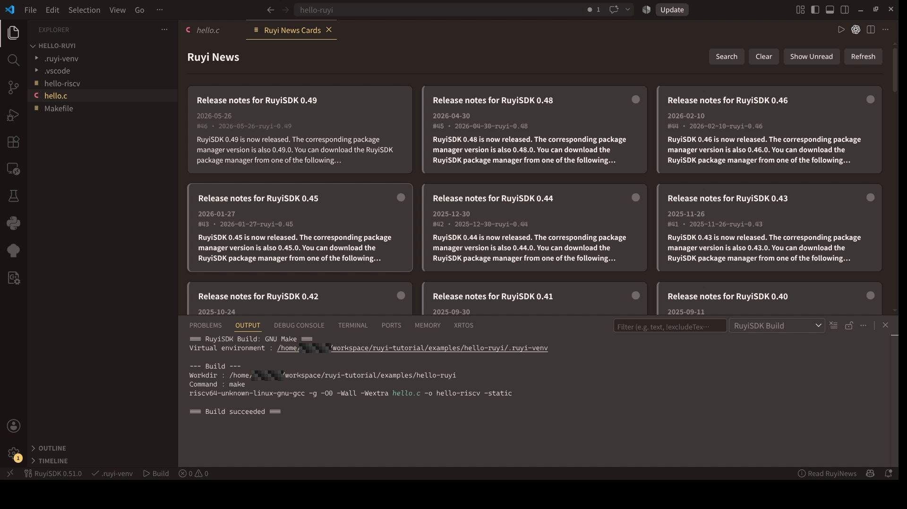
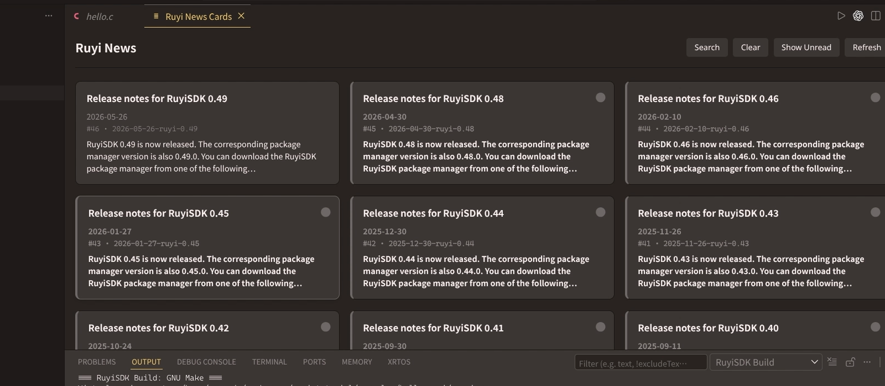
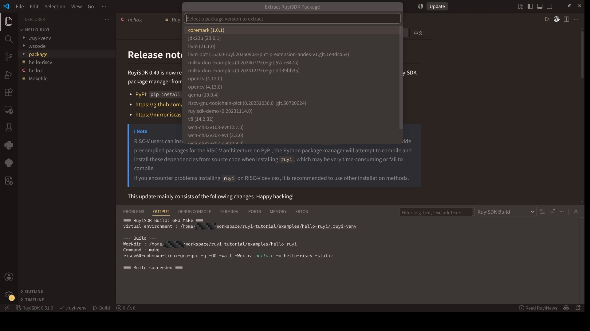
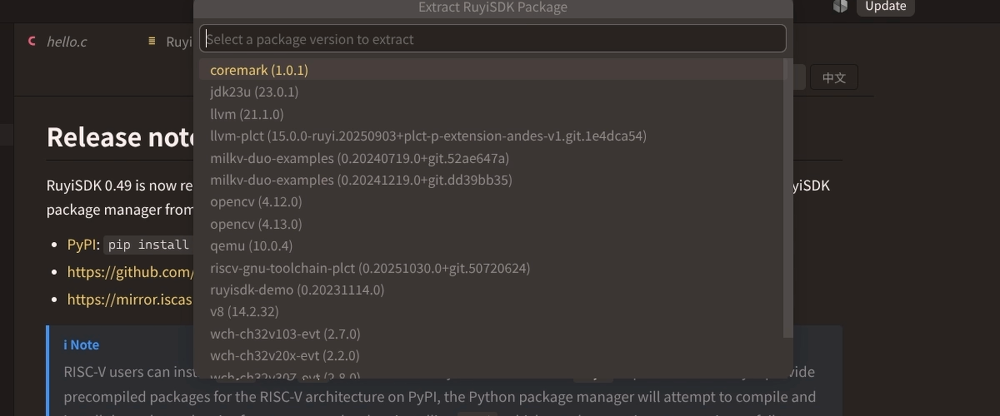
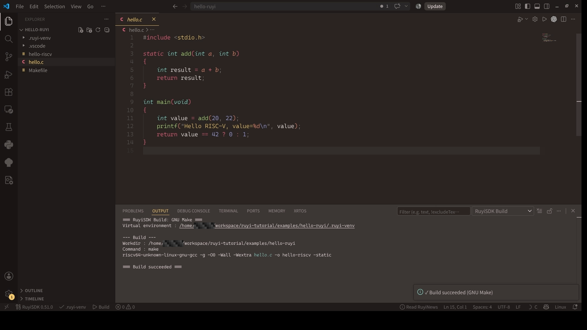
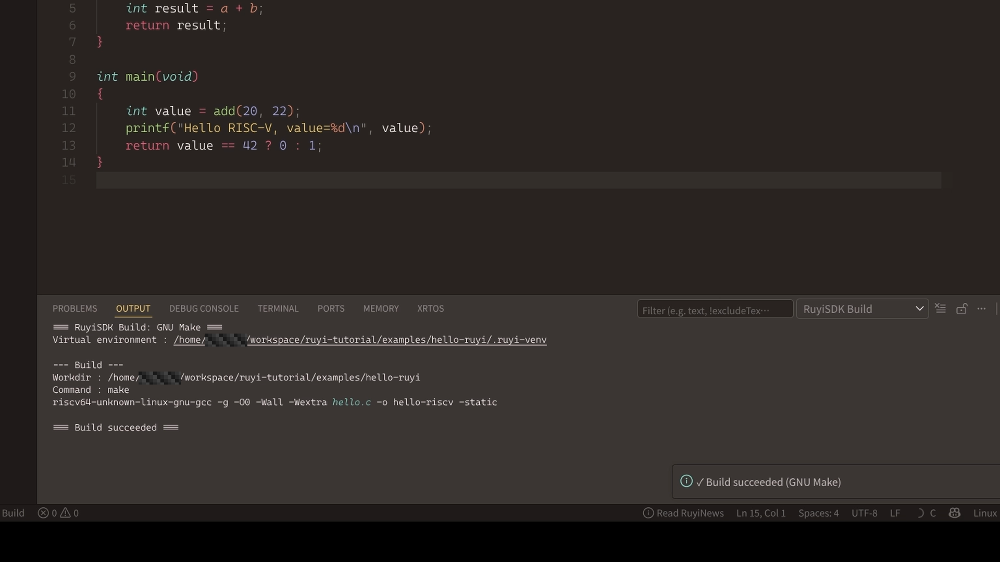
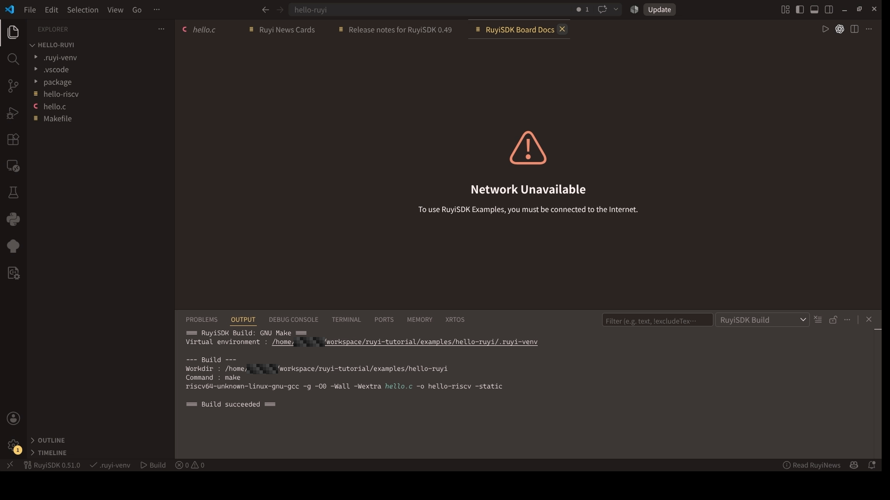
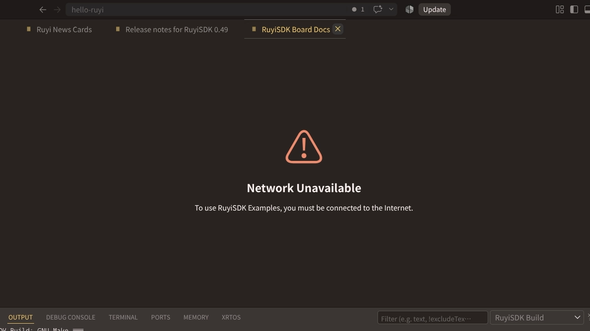

# 【RuyiSDK VS Code 扩展】Linux 篇 04：常用功能

> 本篇标签：`RuyiSDK`、`Linux`、`VS Code`、`RISC-V`、`上手记录`

## News 与状态栏

点击状态栏新闻图标，或执行：

```text
Ruyi: Show News Cards
```

新闻面板支持卡片浏览、未读提示、搜索和 Markdown 详情。

状态栏同时显示当前激活的 venv；点击环境名称可以快速切换。





## Extract RuyiSDK Package

在资源管理器中右键目标文件夹，选择：

```text
Extract RuyiSDK Package
```

中文界面为“提取 RuyiSDK 包”。

它用于下载并展开 `coremark`、`ruyisdk-demo` 等源码包。

操作顺序：

1. 在工作区准备一个目标文件夹。
2. 右键选择 Extract。
3. 选择源码包。
4. 查看提取后项目自带的 README，再决定工具链和构建方式。





## Build Project

扩展可以识别工作区根目录中的 CMake、GNU Make 或 C 项目，并在 `RuyiSDK Build` 输出面板记录命令。入口包括：

```text
Ruyi: Build Project
```

以及状态栏 `Build` 和编辑器标题栏 `Build Project`。






## Board Docs

在首页打开 RuyiSDK 示例，或在命令面板执行 `Ruyi: Show Board Docs`，可以按品牌、型号查看板卡说明和示例。这个入口需要网络。

板卡文档用于确认板型、镜像、工具链和部署步骤。





## 这一篇完成后的检查

```text
[ ] 能打开 News
[ ] 能找到 Extract、Build 和 Board Docs 入口
[ ] 理解软件包安装、源码提取与镜像刷写不是同一操作
```

上一篇：[让扩展找到 Ruyi](03-ruyi-setup.md)  
下一篇：[安装 GNU 工具链、QEMU 和基础工具](05-toolchain-qemu.md)
