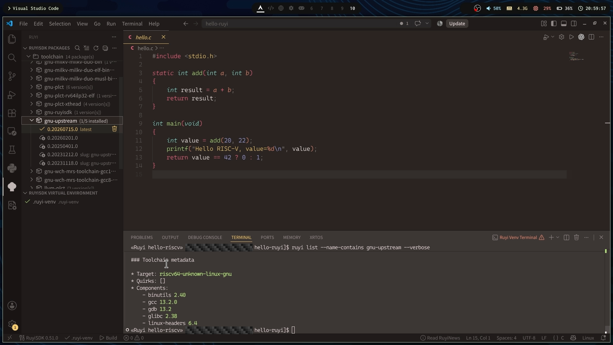
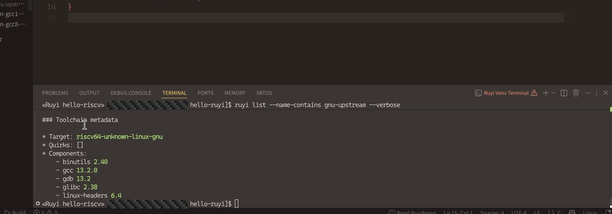
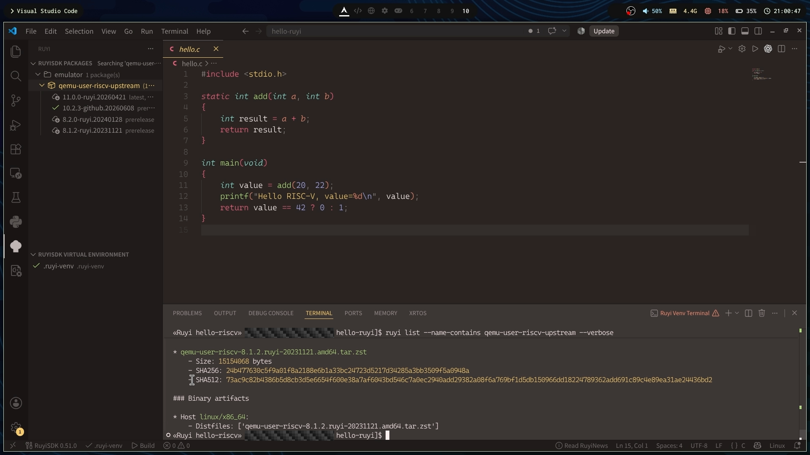
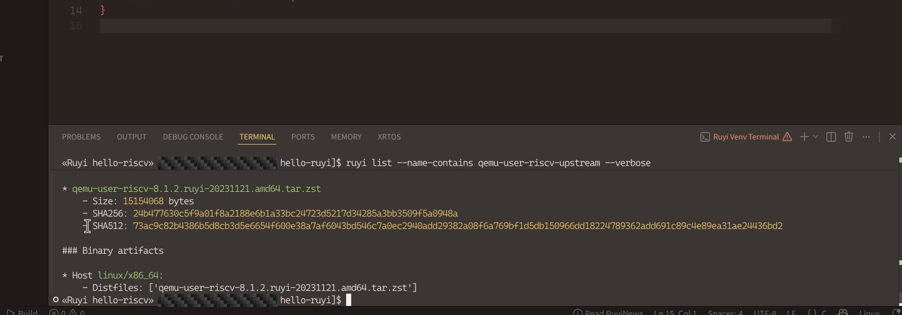

# 【RuyiSDK VS Code 扩展】Linux 篇 05：安装 GNU 工具链、QEMU 

> 本篇标签：`RuyiSDK`、`Linux`、`VS Code`、`RISC-V`、`QEMU`、`交叉编译`、`上手记录`

## 在 Packages 安装 GNU 工具链

1. 打开 `RuyiSDK 软件包`。
2. 搜索 `gnu-upstream`。
3. 展开包名。
4. 选择没有 `no binary for current host` 标记的稳定版本。
5. 点击安装，等待绿色勾选出现。

也可以用 CLI 确认：

```bash
ruyi list --name-contains gnu-upstream --verbose
ruyi list --is-installed y --name-contains gnu-upstream
```

详细信息中的 Target 应为：

```text
riscv64-unknown-linux-gnu
```

后面会用到的编译器和 GDB 命令都以 \riscv64-unknown-linux-gnu-` 为前缀。`。





## QEMU 先按 Host 架构判断

在 Packages 搜索：

```text
qemu-user-riscv-upstream
```

再用 CLI 查看：

```bash
ruyi list --name-contains qemu-user-riscv-upstream --verbose
```


### x86_64 Host：走 Ruyi QEMU 主线

如果所选的 QEMU 软件包版本支持当前 Host：

1. 在 Packages 点击安装。
2. 第 07 篇创建 venv 时选择该模拟器。
3. 激活后使用 venv 生成的 `ruyi-qemu`。






上一篇：[先逛一遍欢迎页和常用功能](04-extension-tour.md)  
下一篇：[准备一个方便调试的 C 示例](06-example-project.md)
